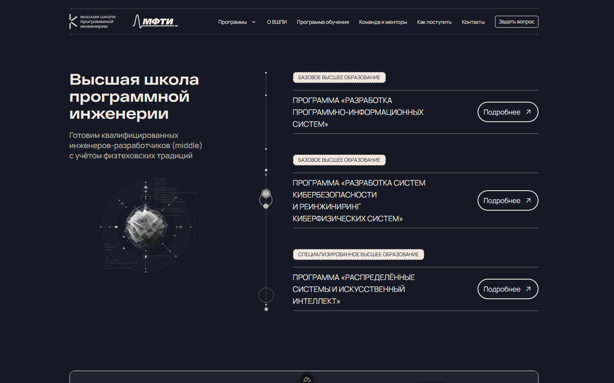
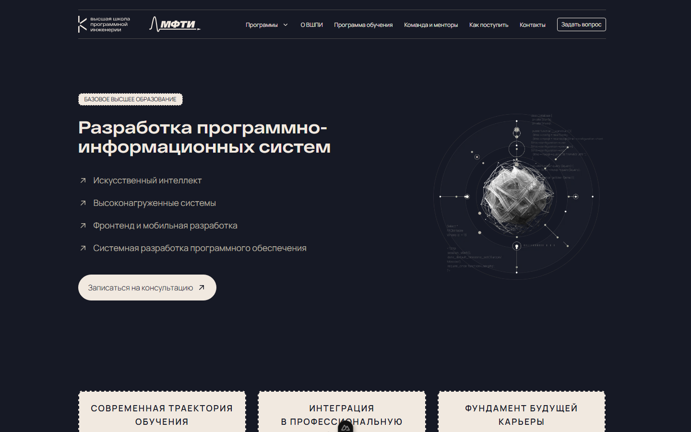

# Высшая школа программной инженерии

Сайт для абитуриентов ВШПИ: образовательные программы, поступление и мероприятия школы в одном месте.

[Живое демо](https://tanzihaosin.github.io/hsse/) · [Посмотреть видео о школе](public/videos/hsse.mp4) · [Быстрый старт](#быстрый-старт)



## О проекте

При выборе программы абитуриенту важно понять, чему он будет учиться, как устроена практика и какие есть возможности для поступления. Сайт объединяет эту информацию со страницами мероприятий, рассказами о проектах, преподавателях и партнёрах школы.

Страницы собраны из самостоятельных виджетов с типизированными данными: это позволяет переиспользовать общие блоки и отдельно развивать содержание каждой страницы.

## Возможности

- Информация о программах базового и специализированного высшего образования.
- Разделы о проектной практике, преподавателях, партнёрах и поступлении.
- Страницы мероприятий, включая день открытых дверей, Standoff и HSSE Night.
- Видео, слайдеры и раскрывающиеся ответы на частые вопросы.
- Форма вопроса с проверкой полей и номера телефона. Отправка вопросов пока не подключена.

## Скриншоты

**Страница образовательной программы**



**Страница мероприятия**


## Технологии

Nuxt 4, Vue 3, TypeScript, Tailwind CSS 4, Nuxt Image и Swiper. Архитектура исходного кода следует принципам Feature-Sliced Design.

## Быстрый старт

Понадобятся Git и Node.js 24 с npm — эта версия Node.js используется в CI.

```bash
git clone https://github.com/tanzihaosin/hsse.git
cd hsse
npm ci
npm run dev
```

Откройте адрес, который выведет Nuxt (обычно <http://localhost:3000>). Команда `npm run dev` сначала проверяет архитектуру FSD, запускает тесты и проверку типов. Для остановки сервера нажмите `Ctrl+C`.

## Как посмотреть проект

На главной странице выберите образовательную программу, чтобы перейти к её описанию. Страницы мероприятий также доступны по адресам `/dod`, `/standoff` и `/hssenight`. В форме вопроса можно проверить заполнение полей; данные никуда не отправляются.

## Проверка и публикация

```bash
npm run lint       # ESLint
npm run lint:fsd   # Проверка архитектуры FSD
npm run typecheck  # Проверка типов
npm test           # Тесты
npm run generate   # Генерация статического сайта
```

Результат генерации находится в `.output/public`. Workflow GitHub Actions проверяет проект и публикует его на GitHub Pages; для сайта в подпапке он задаёт `NUXT_APP_BASE_URL` и отключает провайдер изображений через `NUXT_IMAGE_PROVIDER=none`.

## Структура

```text
src/
├── app/       маршруты, layout и глобальные стили
├── pages/     композиция страниц и их данные
├── widgets/   самостоятельные блоки страниц
└── shared/    общие компоненты, утилиты и ресурсы
public/        изображения, видео и другие статические файлы
```

## Лицензия и связь

Лицензия в репозитории пока не указана. Вопросы о проекте можно обсудить в [репозитории на GitHub](https://github.com/tanzihaosin/hsse).
